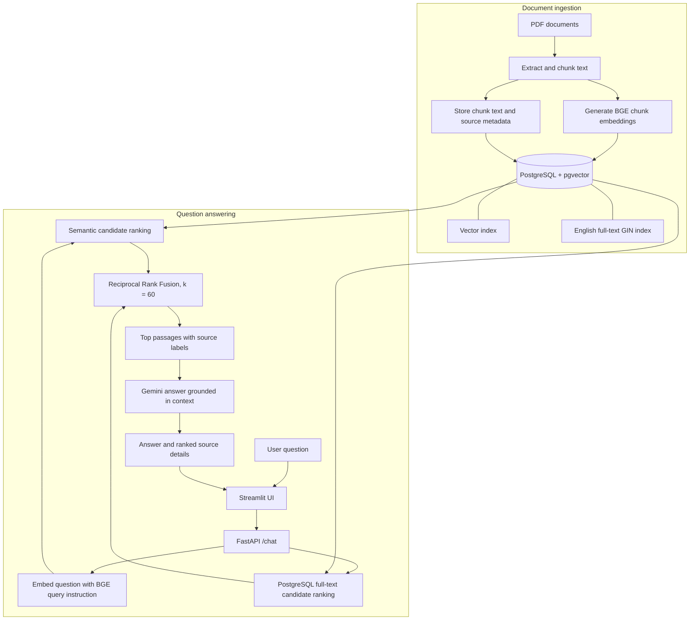

# Local RAG Assistant

A Retrieval-Augmented Generation (RAG) assistant built with:

- FastAPI
- PostgreSQL + pgvector
- Sentence Transformers
- Google Gemini
- Hybrid semantic and keyword search

## Features

- PDF document ingestion
- Recursive chunking
- Embedding generation
- Hybrid semantic and keyword retrieval with Reciprocal Rank Fusion
- Context-aware question answering

## Architecture

The vector and full-text branches search the same stored chunks independently. Reciprocal Rank Fusion combines their rankings before the top passages are sent to Gemini. The GIN index supports keyword retrieval; the vector index supports semantic retrieval.

PNG diagram: [Architecture.png](Architecture.png). Its source can be regenerated with `python docs/render_architecture.py`.

## Workflow:

1. ***Document Ingestion Phase***

* **Upload PDF Documents** : The system reads PDF documents containing the knowledge base using  **PyMuPDF** .
* **Extract Text** : Text is extracted from each page of the PDF and prepared for further processing.
* **Split into Chunks**  : The extracted text is divided into smaller overlapping chunks using **RecursiveCharacterTextSplitter** to maintain context across chunks.
* **Generate Embeddings** : Each text chunk is converted into a dense vector representation using the **Sentence Transformer model (`BAAI/bge-small-en-v1.5`)**.
* **Store in Vector Database** : The text chunks and their corresponding embeddings are stored in **PostgreSQL with pgvector** for efficient semantic search and retrieval.

2. ***Question Answering Phase***

* **User Submits a Question** : The user enters a natural language query through the Streamlit/FastAPI interface.
* **Generate Query Embedding** : The BGE model converts the user's question using its recommended query instruction.
* **Perform Hybrid Search** : pgvector ranks passages by semantic similarity, while PostgreSQL full-text search matches query terms. Reciprocal Rank Fusion (`k = 60`) combines both rankings before the top chunks are sent to Gemini.
* **Build Context-Aware Prompt** : The retrieved document chunks are combined with the user's question to construct a context-rich prompt for the LLM.
* **Generate Response with Gemini** : The **Gemini LLM** processes the prompt and generates an answer grounded in the retrieved document context.
* **Return Final Answer** : The generated answer, along with the retrieved supporting sources, is presented to the user through the application interface.

## Run

1. pip install -r requirements.txt
2. docker compose up -d
3. python -m scripts.migrate_hybrid_search
4. python -m scripts.ingest_pdf data/sample.pdf
5. uvicorn app.api:app --reload
6. streamlit run ui/streamlit_app.py

The migration creates the full-text GIN index used by hybrid search. It is safe to run more than once and does not require re-ingesting documents. The PDF ingestion step replaces existing chunks for that file and refreshes their embeddings.
